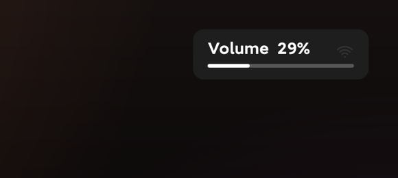
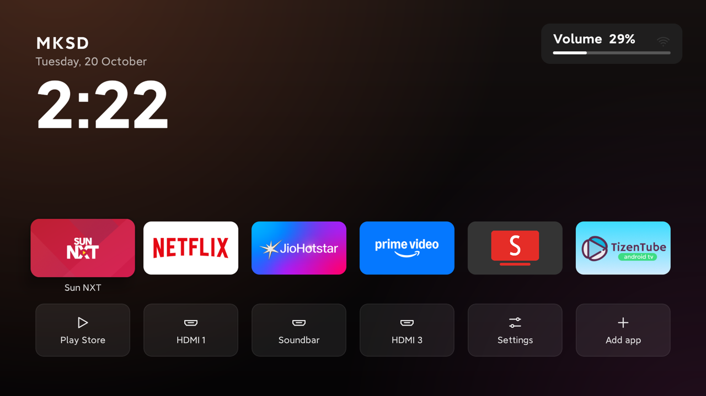

# Volume Bar for Android TV

A tiny Android TV app (about 20 KB) that shows your **soundbar's volume level on screen** as `Volume 29%` with a bar.



It is for TVs that hide their own volume bar once a soundbar is connected over **HDMI eARC / ARC**, and for soundbars with no number display. Many LG soundbars only show the level as a coloured light (green, yellow, red), so you never know the real number.

On the full TV screen, it sits in the top-right corner over whatever is on:



## How it works

When a soundbar is connected over HDMI-CEC, it reports its volume (0–100) back to the TV, and Android keeps that as the music volume. The TV often just doesn't draw it. This app listens for volume changes and draws a small box in the top-right corner for 2.5 seconds.

- **Live number while you hold the button.** When you hold volume up or down, the number keeps moving, then settles on the level the soundbar really reports.
- **Hidden on TV speakers.** When sound plays on the TV's own speakers, the TV already shows its bar, so this app stays out of the way.
- **Starts at boot**, with no need to open the app.
- No ads, no tracking, never goes on the internet. (It only talks to the TV itself, for the one-time automatic setup.)

## Tested on

| TV | Soundbar | Result |
|---|---|---|
| Xiaomi / Redmi Android TV 10 (2021) | LG soundbar on eARC | The volume logic works; v1.0 of this app is being tested |

If you try it on another TV or soundbar, please open an issue with the result. It should work on any Android TV 8.0+ that receives the soundbar's volume over CEC.

## Install (no computer needed)

All on the TV, with the remote. About 5 minutes, once.

### 1. Download the app

1. On the TV, open the **Play Store** and install **Downloader** (by AFTVnews). It's free.
2. Open **Downloader** and type this address in the box:
   ```
   github.com/muniv24/lg-soundbar-volume-bar-for-android-tv/releases/latest/download/volumebar.apk
   ```
3. Press **Go**. When it has downloaded, press **Install**.
4. The first time, the TV says it can't install apps from unknown sources. Press **Settings**, switch **Downloader** to **allowed**, go back, and press **Install** again.
5. Press **Done**. You can delete the downloaded file when Downloader asks.

### 2. Give it permission to show over other apps

Open **Volume Bar** from your TV's apps.

- **Most TVs** (Google TV, Sony, TCL, and others): press **Open the permission screen**, switch **Volume Bar** **on**, and press Back.
- **If the TV says it has no permission screen** (for example Xiaomi / Redmi): press **Set up automatically**.
  - If it says debugging is off, turn it on once:
    1. Settings › Device Preferences › About: press **Build** 7 times, until it says you are a developer.
    2. Settings › Device Preferences › Developer options: turn on **USB debugging** (and **Network debugging** if you see it).
  - Press **Set up automatically** again. The TV asks **"Allow debugging?"**: tick **Always allow** and press **OK**.
  - You can turn debugging off again afterwards. The permission stays.

### 3. Done

The screen shows **Ready**. Press **Show a test**, or just press volume up or down. From now on it starts by itself every time the TV starts.

To remove it: Settings › Apps › Volume Bar › **Uninstall**.

<details>
<summary><b>Advanced: install from a computer with adb</b></summary>

`adb` is Google's tool for controlling an Android device from a computer. If you already use it:

```sh
adb connect <TV_IP>:5555
adb install volumebar.apk
adb shell appops set com.muniv24.volumebar SYSTEM_ALERT_WINDOW allow
```
</details>

## Build

Needs Java 17 and the Android SDK (platform 34, build-tools 34). No Gradle or Android Studio needed:

```sh
sh android/build.sh        # makes android/out/volumebar.apk
```

Keep `android/key.jks`, which the first build makes: updates must be signed with the same key.

## Code

All in `android/src/com/muniv24/volumebar/`:

| File | What it does |
|---|---|
| `SoundbarVolume.java` | Reads the soundbar's level (0–100), mute, and whether sound is on the TV speakers |
| `VolumeBarView.java` | Draws the card with `Volume 29%` and the bar |
| `VolumeService.java` | Listens for volume changes and shows the bar; handles a held button |
| `SettingsActivity.java` | The app's screen: on/off, test, permission |
| `LocalAdb.java` | "Set up automatically": runs one command through the TV's own debugging (127.0.0.1) |
| `AdbKey.java` | The app's debugging key, which the TV asks you to allow once |
| `Prefs.java` | The on/off setting |
| `BootReceiver.java` | Starts the bar when the TV starts |

## License

MIT
